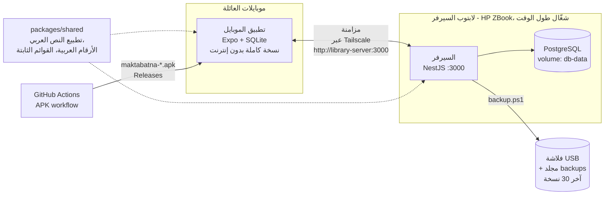

<div dir="rtl">

# 📚 مكتبتنا

> تطبيق موبايل لأرشفة وتنظيم مكتبة البيت. بيعرّفك كل كتاب شو هو، ووين موجود بالضبط (الغرفة، والمكتبة، والقسم، والرف)، مع عرض 3D للمكتبات.


---

## 📌 نظرة عامة

مكتبتنا تطبيق موبايل لأرشفة وتنظيم مكتبة البيت. بيعرّفك كل كتاب شو هو، ووين موجود بالضبط (الغرفة، والمكتبة، والقسم، والرف)، مع عرض 3D للمكتبات.

- **المرجع الكامل** للمشروع وكل القرارات: [`docs/PROJECT_BRIEF.md`](docs/PROJECT_BRIEF.md)
- **ترقيم المكتبات:** [`docs/rooms/`](docs/rooms)
- **إدخال الكتب:** قالب الإكسل [`data/books-template.xlsx`](data/books-template.xlsx)، وتعليمات محادثة الصوت [`docs/VOICE_ENTRY_PROMPT.md`](docs/VOICE_ENTRY_PROMPT.md)

---

## ✨ الميزات الرئيسية

- **الموقع الدقيق للكتاب** — كل كتاب مرتبط بغرفته ومكتبته وقسمه ورفّه
- **عرض 3D للمكتبات** — تصفّح المكتبات بشكل مرئي
- **يعمل بدون إنترنت** — كل موبايل عنده نسخة كاملة من الكتب
- **مزامنة تلقائية** — التعديلات بتنبعت للسيرفر لحالها بعد كم ثانية، وكل كم دقيقة، ولما تفتح التطبيق، مع زر «مزامنة الآن» وشاشة بتبيّن الحالة
- **أكثر من طريقة لإدخال الكتب** — عبر قالب الإكسل، أو عبر محادثة صوتية بتعليمات مخصصة
- **حسابات أهل البيت برمز دعوة** — كل فرد من العائلة بيفتح حسابه برمز الدعوة
- **حسابات المشرفين** — حساب الأب والأم هم بس يلي بيتحكموا بالتحديات والنقاط والمكافآت
- **تسجيل الدخول بحساب Google** — متاح كطريقة دخول اختيارية
- **اتصال خاص عبر Tailscale** — الموبايلات بتوصل لسيرفر البيت من أي مكان، ومجاناً
- **تثبيت عبر APK** — بينبنى تلقائياً على GitHub وبينثبّت مباشرة على موبايلات أندرويد
- **نسخ احتياطي** — يدوي ومجدول على فلاشة، مع سكربت استرجاع
- **معالجة النص العربي** — كود مشترك لتطبيع النص العربي، والأرقام العربية، والقوائم الثابتة

---

## 🏗️ المعمارية (Architecture)



**ملاحظات:**
- 📱 التطبيق يعمل بمبدأ **offline-first**: البيانات كلها على الموبايل بـ SQLite وبتتزامن مع السيرفر وقت ما يتوفر اتصال
- 🔐 تسجيل الدخول بيمرّ عبر السيرفر (رمز الدعوة أو حساب Google)
- 🌍 **Tailscale** بيخلّي الموبايلات توصل للسيرفر من أي شبكة بدون فتح بورتات

---

## 🛠️ التقنيات المستخدمة (Tech Stack)

| الطبقة | التقنية |
|---|---|
| تطبيق الموبايل | Expo + SQLite |
| السيرفر | NestJS + PostgreSQL |
| تشغيل السيرفر | Docker (Docker Compose) على لابتوب ويندوز |
| الوصول عن بُعد | Tailscale |
| الكود المشترك | حزمة TypeScript (`packages/shared`) |
| migrations الموبايل | Drizzle |
| migrations السيرفر | Prisma |
| البناء والتوزيع | GitHub Actions (APK) + GitHub Releases |

---

## 📂 محتويات المستودع

| المسار | الوصف |
|---|---|
| `apps/mobile` | تطبيق الموبايل (Expo + SQLite) |
| `apps/server` | السيرفر (NestJS + PostgreSQL) |
| `packages/shared` | كود مشترك: تطبيع النص العربي، والأرقام العربية، والقوائم الثابتة |
| `docs/PROJECT_BRIEF.md` | المرجع الكامل للمشروع وكل القرارات |
| `docs/rooms/` | ترقيم المكتبات |
| `docs/VOICE_ENTRY_PROMPT.md` | تعليمات محادثة الصوت لإدخال الكتب |
| `docs/GOOGLE_SIGN_IN.md` | خطوات إعداد الدخول بحساب Google |
| `data/books-template.xlsx` | قالب الإكسل لإدخال الكتب |
| `scripts/backup.ps1` / `scripts/restore.ps1` | سكربتات النسخ الاحتياطي والاسترجاع |

### هيكل المشروع

```
apps/mobile      تطبيق الموبايل (Expo + SQLite)
apps/server      السيرفر (NestJS + PostgreSQL)
packages/shared  كود مشترك: تطبيع النص العربي، والأرقام العربية، والقوائم الثابتة
```

---

## ⚙️ التشغيل

### التشغيل على لابتوب الشغل (ويندوز)

التطبيق بيحتاج شغلتين شغّالين على اللابتوب:
1. **السيرفر**، مشان تسجيل الدخول.
2. **سيرفر التطوير تبع Expo**، يلي بيبعت التطبيق للموبايل.

#### مرة وحدة بس
1. نزّل **Git** و**Node.js LTS** و**Docker Desktop** (القسم 5 بملف المشروع)، وشغّل Docker Desktop.
2. نزّل **Expo Go** على الموبايل من Play Store، و**وقّف التحديث التلقائي** إلو.
3. بـ PowerShell:
   ```powershell
   git clone https://github.com/BADR-14/maktabatna.git
   cd maktabatna
   npm install
   ```
4. اعمل ملف الإعدادات `.env`، وغيّر `bayt2026` لرمز الدعوة يلي بدك ياه:
   ```powershell
   $secret = -join ((48..57)+(65..90)+(97..122) | Get-Random -Count 48 | ForEach-Object {[char]$_})
   Set-Content .env "JWT_SECRET=$secret`nINVITE_CODE=bayt2026`nPOSTGRES_PASSWORD=maktabatna"
   ```
   رمز الدعوة هو يلي بيحتاجه أهل البيت ليفتحوا حساب.
5. حط أسماء مستخدمي المشرفين (حساب الأب والأم) بسطر جديد بملف `.env`، مفصولين بفاصلة. هدول بس بيتحكّموا بالتحديات والنقاط والمكافآت:
   ```
   ADMIN_USERNAMES=abu_ahmad,um_ahmad
   ```
   بعد أي تعديل على `.env`، شغّل `docker compose up -d --build`.

#### كل مرة
**1. شغّل السيرفر** (Docker Desktop لازم يكون شغّال):
```powershell
cd maktabatna
git checkout -- package-lock.json
git pull
npm install
docker compose up -d --build
```
للتأكد، افتح `http://localhost:3000/health` بالمتصفح، ولازم يطلع `{"status":"ok"}`.

**2. شغّل التطبيق:**
```powershell
npm run mobile -- --clear
```
- امسح الـ **QR** بـ Expo Go. الموبايل لازم يكون على **نفس الواي فاي**، **والـ VPN مطفي**.
- أول مرة: اكبس **«افتح حساب جديد»**، وحط رمز الدعوة.
- إذا طلب Windows Firewall إذن لـ Docker أو Node، اختار **Allow**.

> إذا ما قدر التطبيق يوصل للسيرفر، اكبس «عنوان السيرفر» بشاشة الدخول. لازم يكون `http://<عنوان اللابتوب>:3000`، وهو نفس العنوان يلي بيطلع جنب `exp://` بالـ PowerShell.

### التشغيل الحقيقي: لابتوب السيرفر + التطبيق المثبّت

#### ١. لابتوب السيرفر (HP ZBook، شغّال طول الوقت)
1. نفس خطوات «مرة وحدة بس» فوق (Git وNode وDocker، والـ clone، وملف `.env`).
2. شغّل السيرفر:
   ```powershell
   docker compose up -d --build
   ```
   Docker Desktop لازم يشتغل مع Windows: **Settings ← General ← Start Docker Desktop when you sign in**.
3. **بعد كل تحديث:**
   ```powershell
   git pull
   docker compose up -d --build
   ```
   البيانات محفوظة بـ Docker volume اسمه `db-data`، وما بتضيع مع إعادة البناء.

#### ٢. Tailscale (مجاني): الموبايلات بتوصل للسيرفر من أي مكان
1. نزّل **Tailscale** على لابتوب السيرفر وعلى كل موبايل، وسجّل دخول **بنفس الحساب** عليهم كلهم.
2. من <https://login.tailscale.com/admin/machines>، غيّر اسم لابتوب السيرفر لـ **`library-server`** (من ⋯ ← Edit machine name).
3. بهيك التطبيق بيلاقي السيرفر لحاله على `http://library-server:3000`، وما في داعي تكتب عنوان.
   > إذا ما زبط، بشاشة الدخول اكبس «عنوان الخادم»، واكتب `http://<عنوان Tailscale للابتوب>:3000` (العنوان يلي بيبلّش بـ `100.`).

#### ٣. تثبيت التطبيق على الموبايلات (APK)
1. التطبيق بينبنى لحاله على GitHub. آخر نسخة بتلاقيها هون: <https://github.com/BADR-14/maktabatna/releases>
2. من الموبايل افتح الرابط، ونزّل ملف `maktabatna-….apk`، وافتحه.
3. أول مرة Android بيطلب إذن **«تثبيت تطبيقات من مصادر غير معروفة»** للمتصفح: اسمح.
4. **نسخة جديدة:** من GitHub ← **Actions ← APK ← Run workflow**. بعد حوالي ٢٠ دقيقة بتطلع بـ Releases، وبتنزّلها وبتثبّتها **فوق القديمة**، وما بتضيع البيانات.

#### ٤. الدخول بحساب Google
الخطوات بـ [`docs/GOOGLE_SIGN_IN.md`](docs/GOOGLE_SIGN_IN.md). بتنعمل مرة وحدة، ومجانية.

#### ٥. المزامنة
- كل موبايل عنده نسخة كاملة من الكتب، وبيشتغل بدون إنترنت.
- التعديلات بتنبعت للسيرفر لحالها بعد كم ثانية، وكل كم دقيقة، ولما تفتح التطبيق.
- حالتها بتبيّن بـ **الملف الشخصي ← المزامنة مع الخادم**، ومن هونيك في زر «مزامنة الآن».

#### ٦. النسخ الاحتياطي على فلاشة
على لابتوب السيرفر، بـ PowerShell جوا مجلد `maktabatna`:
```powershell
.\scripts\backup.ps1 -To E:\
```
(`E:\` هو حرف الفلاشة.) النسخة بتنحفظ كمان بمجلد `backups`، وبيضل فيه آخر ٣٠ نسخة.

- **نسخة تلقائية كل يوم:** افتح **Task Scheduler ← Create Basic Task**، وخليها يومية. بخانة **Program** اكتب `powershell`، وبخانة **Arguments**:
  `-ExecutionPolicy Bypass -File C:\Users\BADR\maktabatna\scripts\backup.ps1`
- **الاسترجاع** (بيستبدل بيانات السيرفر):
  ```powershell
  .\scripts\restore.ps1 -File backups\maktabatna-2026-09-27_2100.dump
  ```
- إذا PowerShell رفض يشغّل السكربت، شغّل مرة وحدة: `Set-ExecutionPolicy -Scope CurrentUser RemoteSigned`

---

## 🧑‍💻 للمطوّر

| الأمر | شو بيعمل |
|---|---|
| `npm test` | اختبارات الكود المشترك |
| `npm run typecheck` | فحص TypeScript لكل المشروع |
| `npx eslint .` (جوا `apps/mobile`) | فحص الكود |
| `npx drizzle-kit generate` (جوا `apps/mobile`) | migration جديدة بعد تعديل `src/db/schema.ts` |
| `node scripts/build-seed-sql.mjs` (جوا `apps/mobile`) | إعادة توليد بيانات الغرف والمكتبات |
| `npx prisma migrate dev` (جوا `apps/server`) | migration جديدة للسيرفر بعد تعديل `prisma/schema.prisma` |

---

## 👤 المطوّر / التواصل

**Badr AlDeen AlSaudi** — مهندس برمجيات (تطوير الويب)

- LinkedIn: [رابط لينكدإن هون]
- Portfolio: [رابط البورتفوليو هون]
- Email: [إيميلك هون]
- GitHub: [رابط حساب GitHub هون]

---

## 📄 الرخصة

هذا المشروع مرخّص بموجب رخصة MIT، راجع ملف [LICENSE](LICENSE) للتفاصيل.

</div>
